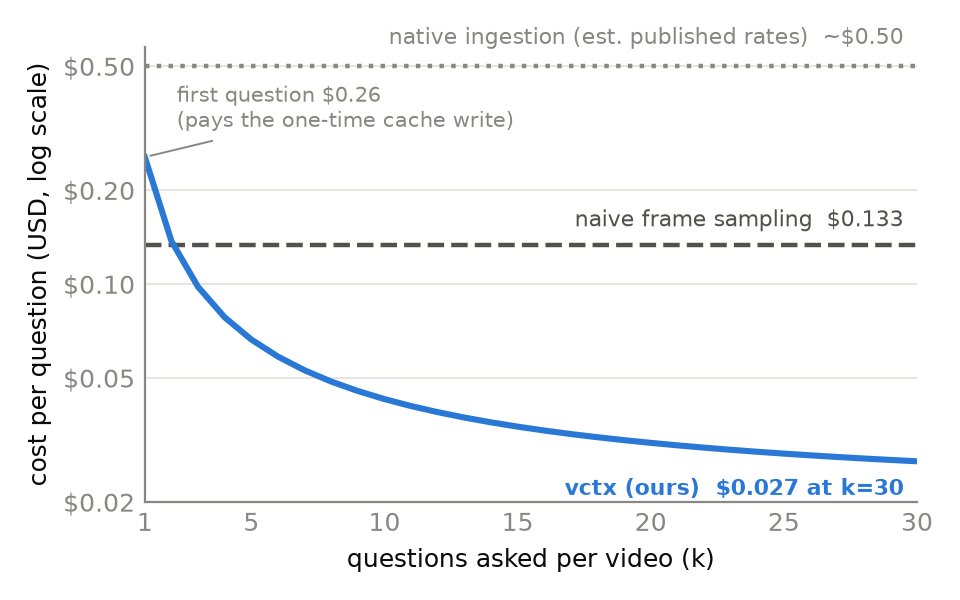

# Index Once, Ask Forever: A Model-Free Video Context Layer and an Accuracy-per-Dollar Benchmark for Video QA with LLM Agents

**Fred Dunyo**
*Draft v0.1, 2026-10-17. Numbers marked [PENDING] await runs in progress.*

## Abstract

Most LLM agents cannot read video, and the systems that can (native video
ingestion, proprietary video foundation models) re-tokenize the entire video
on every question, making repeated interaction with long footage economically
prohibitive. We present **vctx**, an open, model-free video context format: a
video is indexed once, locally, using only commodity tools (ffmpeg shot
detection and keyframes, open speech-to-text, optional cheap VLM captions)
into a portable directory of JSON and JPEG. An agent answers questions from
the index's cheap text layer and escalates to individual frames only when the
question requires pixels, under an evidence rule that forbids answering visual
questions without fetched visual evidence. We also introduce an
**accuracy-per-dollar** evaluation protocol for video QA that charges every
token honestly, including prompt-cache write premiums, and measures cost as a
function of questions asked per video. On Video-MME short videos (held-out
test half, n=150), the frozen vctx configuration with Claude Opus 4.8 scores
80.7% at $0.025 per question (equivalent configurations ranged 80.7-85.3%
across runs), versus 74.0% at $0.0172 for a uniform frame-sampling baseline.
On Video-MME long videos (n=30), vctx reaches 80.0% (replicated exactly
across runs) at $0.098 per question versus 70.0% at $0.133 for sampling;
follow-up questions on an already-warm index cost $0.019, roughly 25x below
the estimated cost of native ingestion of the same hour-long video. We also
quantify run-to-run variance and locate it almost entirely in the
frame-fetching path, with consequences for how small accuracy deltas on this
benchmark should be read. The format specification,
reference implementation, MCP server, and evaluation harness are released
under Apache-2.0.

## 1. Introduction

Images became a first-class input for LLMs years ago; video has not. The
providers that do accept video natively charge for every second of footage on
every request: an hour of video is roughly 250-350k tokens per question, paid
again for each follow-up. Proprietary video-understanding platforms index
video into closed representations behind per-minute pricing. There is no
equivalent of what Markdown is to documents: an open, portable, model-free
representation that any agent can consume.

This paper makes three contributions:

1. **The vctx format** (Section 3): a specification for turning any video
   into a compact, self-contained context directory using only local, free
   tools, with optional enrichment layers (captions, and in future versions
   OCR and embeddings) that record their provenance.
2. **A text-first query protocol** (Section 4): the agent reads a ~1-20k
   token text rendering of the video first, and escalates through a cheap
   thumbnail survey to targeted full-resolution frame extraction, governed by
   an evidence rule that measurably suppresses visual hallucination.
3. **An accuracy-per-dollar benchmark protocol** (Section 5): cost accounting
   that includes cache-write premiums (which we show can silently triple
   apparent costs when ignored), and reporting cost as a function of
   questions-per-video, which exposes the amortization structure that
   single-question evaluations hide.

We deliberately do not train a model. The claim under test is architectural:
that a well-structured, model-free index in front of a general-purpose
multimodal LLM is more accurate than uniform frame sampling and dramatically
cheaper than native ingestion for any workload that asks more than one
question per video.

## 2. Related Work

**Native video ingestion.** Gemini ingests video directly at roughly one
frame per second plus audio tokens; GPT-5 accepts video input. Both charge
full ingestion per request. We treat native ingestion as the capability
ceiling and price floor-antagonist: our question is how much of its accuracy
survives at a fraction of its cost. [Citations to be added.]

**Proprietary video platforms.** Twelve Labs (Marengo, Pegasus) exposes video
foundation models, embeddings, and an MCP server as a hosted API priced per
indexed minute. VideoDB and similar offer managed video RAG. vctx differs on
two axes: the index is produced by free local tools rather than proprietary
models, and the artifact is an open on-disk format rather than an API-side
state. [Citations to be added.]

**Video RAG research.** Retrieval-augmented approaches to long-video QA
(VideoAgent, VideoTree, and successors) share our coarse-to-fine intuition.
Most report accuracy only; none to our knowledge publish an honest
cost-per-question accounting or an open interchange format. Our contribution
is the format + benchmark pairing rather than a novel retrieval algorithm.
[Citations to be added.]

**Benchmarks.** We evaluate on Video-MME, the standard multi-duration video
QA benchmark (short <=2 min, medium 4-15 min, long 30-60 min; 3 questions per
video). Gold labels are multiple choice. We note observed label disputes in
Section 7.4.

## 3. The vctx Format

A vctx index is a directory:

```
video.vctx/
  manifest.json   # format version, producer, parameters, source hash + path hint
  index.json      # shots, keyframes, transcript, captions
  frames/         # extracted JPEG keyframes and on-demand frames
```

Indexing uses only local tools: ffprobe (metadata), PySceneDetect
(shot boundaries, with a fixed-window fallback for cut-free footage), ffmpeg
(keyframes, one per shot plus one per 20s within long shots, long edge 768px),
and faster-whisper (transcript with per-segment timestamps). An optional
caption pass annotates up to 150 shots per video with one-line visual
descriptions from a cheap VLM (we use Claude Haiku 4.5; ~$0.10 per hour-long
video, one time). The manifest records every parameter and model used.

Indexing is idempotent, portable (plain JSON/JPEG), and cheap: roughly
10-20% of video duration on a laptop CPU, dominated by transcription.

**Design rule: the cap on enrichment is a property of the index, not of the
enrichment call.** An early implementation capped captions per call; repeated
calls quietly accumulated 3x the intended captions and tripled the text-layer
size (Section 7.3). The specification therefore states caps as index
invariants.

## 4. Query Protocol

The consumer contract exposes three operations: `text_view()` (compact text
rendering), `get_frames(t0, t1, n, detail)` (frames extracted on demand from
the source at requested density and resolution), and `survey()` (one small
thumbnail per shot, subsampled to 24). Our reference agent loop supplies
these to the model as tools, with a system prompt encoding four rules:

1. **Text first.** The text view (shot structure + captions + transcript,
   interleaved by timestamp; speech grouped into ~25s blocks; caption-less
   silent spans collapsed) answers most questions alone.
2. **Captions are lossy.** Counting, colors, patterns, and on-screen text
   must be verified against frames, never answered from captions.
3. **Enumeration protocol.** "How many" / "first time" / "which option is
   false" questions require a systematic sweep before answering.
4. **Evidence rule.** A visual answer must cite a fetched frame's timestamp;
   if fetched frames do not show the answer, fetch different ones rather than
   guess. General world knowledge may never substitute for missing pixels.

The text view is marked as a prompt-cache prefix (1-hour TTL above 20k
characters, default TTL below), so every question after the first reads the
video's context at ~10% of input price.

## 5. Benchmark Protocol: Accuracy per Dollar

Each method answers multiple-choice questions and reports its own fully
loaded cost. Three accounting rules matter more than they appear:

1. **Cache writes are charged at their premium** (1.25x for 5-minute TTL, 2x
   for 1-hour TTL on the provider we use). In our logs, ignoring cache-write
   tokens understated long-video costs by up to 2.3x. Any cached-prefix
   system evaluated without this rule will report fantasy costs.
2. **One-time index costs are reported separately and amortized explicitly.**
   Indexing + captioning a 100-video short corpus cost $0.99 total; we report
   it alongside, not hidden inside, per-question costs.
3. **Cost is a function of questions-per-video.** We report first-question
   and follow-up costs separately (Section 6.4). Single-question evaluation
   structurally favors stateless methods and hides the central advantage of
   indexed ones.

Methods compared: **vctx** (this work); **naive sampling** (uniform frames at
1 per 10s, capped at 60, single request, no transcript: the de facto standard
workaround today); **native ingestion** (Gemini; the video is uploaded and
ingested per question). Letter extraction from free-text answers uses a
three-stage parser validated against manual reads; an earlier single-pass
parser mis-scored 20% of one method's answers (Section 7.3).

All experiments use Claude Opus 4.8 as the query model for vctx and naive;
captions use Claude Haiku 4.5. Dev/test splits are by video. The vctx
configuration was frozen on the pilot + dev half; the test half was touched
once.

## 6. Results

### 6.1 Short videos (Video-MME short, 100 videos, 300 questions)

| Method | Dev (150q) | Test (150q) | $/question (test) |
|---|---|---|---|
| vctx (frozen v0.2, one touch) | 84.0-86.0% band | **80.7%** | $0.025 |
| Naive sampling | n/a | 74.0% | $0.0172 |
| Native (Gemini 3 Flash)* | n/a | 53.3% | $0.0047 paid-equiv |

*Native column measured on the 30-question pilot subset (free-tier quota
limits); on those same 30 questions vctx scores 76.7% and naive 60.0%. The
native row uses Gemini's budget tier; the Pro-tier column remains [PENDING]
on paid access.

One-time corpus cost (index + captions, all 100 videos): $0.99. Dev and test
agree within 2 points; nothing was tuned on the test half.

Note that even if Pro-tier native matches vctx accuracy on short videos,
short clips are native ingestion's *best* cost case, ~2k tokens per clip, and
its economics collapse on long video (6.4). Native ingestion also paid a
measured ~40s of upload + processing latency per question versus vctx's 2-4s
text-path answers.

### 6.2 Medium videos (Video-MME medium, 4-15 min, 30 questions)

Our weakest cell, which we report rather than omit:

| Method | Accuracy | $/question |
|---|---|---|
| Naive sampling | **80.0%** | $0.081 |
| vctx (frozen v0.2, one touch) | 66.7% (earlier run: 76.7%) | $0.053 |
| Native (Gemini Flash-Lite) | 70.0% | $0.0034 |

At 4-15 minutes, a uniform frame grid still covers the video densely enough
to answer most questions while the vctx text view is already summarizing
away detail; the one-touch run and an earlier equivalent run differ by 10
points (3 questions), making this the most variance-dominated cell (7.4).
Medium is the named target for the next iteration; candidate levers are
caption density and retrieval-stabilized frame targeting, to be evaluated
on the medium dev split first.

### 6.3 Long videos (Video-MME long, 10 videos of 30-60 min, 30 questions)

| Method | Accuracy | $/question | Wall-clock/question |
|---|---|---|---|
| vctx (ours) | **80.0%** | **$0.098** | median 4s |
| Naive sampling (60-frame cap) | 70.0% | $0.133 | ~6s |
| Native ingestion (Gemini 3.1 Pro, published rates) | [PENDING] | ~$0.50-0.70 est. | ~40s+ observed on Flash |

vctx's text layer alone answered 28 of 30 questions (23 correct); the frame
path handled 2. Accuracy on long videos (80.0%) matches short (83.3%),
consistent with the index's size being decoupled from video duration.

### 6.4 Amortization: the central figure

Measured from the frozen long-video run (FINAL_long30): the **first**
question on a video averages $0.256 (it pays the one-time cache write of the
text view); every **follow-up** inside the cache window averages **$0.019**.
Per-question cost at k questions per video:

| k (questions/video) | vctx | naive | native (est.) |
|---|---|---|---|
| 1 | $0.256 | $0.133 | ~$0.50 |
| 3 | $0.098 | $0.133 | ~$0.50 |
| 10 | $0.043 | $0.133 | ~$0.50 |
| 30 | $0.027 | $0.133 | ~$0.50 |



Stateless methods are flat lines; vctx is a decaying curve that crosses naive
between k=2 and k=3 and sits an order of magnitude below native from k=3
onward (Figure 1). Agent
workloads (an assistant discussing a lecture, a reviewer auditing a meeting
recording) are precisely the k>>1 regime.

### 6.5 Latency

Native ingestion re-uploads and re-processes the video per question (observed
~40s+ per question on short clips). vctx's text-path answers return in ~2-4s.
For interactive agents this is the difference between conversational and
batch.

## 7. Analysis

### 7.1 Where accuracy comes from

Path split on the short test half: text-only answered 90/150 questions at
90% accuracy for ~$0.003 each; the frame path handled 60/150 at 73%. The
protocol's cost efficiency comes from the text layer absorbing most
questions; its accuracy ceiling is currently set by the frame path.

### 7.2 Ablation ladder (pilot, 30 questions)

| Configuration | Accuracy | Cost |
|---|---|---|
| Shot-midpoint keyframes only | 60.0% | $0.54 |
| + on-demand frame extraction | 70.0% | $0.75 |
| + captions, survey tool, evidence rule, cache | 76.7% | $0.20 |
| + detail escalation, enumeration rule (frozen config) | 76.7% | $0.29 |

The largest single gain (and simultaneous 73% cost cut) came from giving the
text layer visual captions: 5 questions stopped needing frames at all, and
blind time-range guessing largely disappeared.

### 7.3 Negative results and accounting traps (what we had to fix)

We report these because a cost benchmark is only as credible as its
bookkeeping: (a) uncounted cache-write tokens understated long-video costs by
up to 2.3x; (b) 5-minute cache TTL silently lapsed between questions under
rate-limit stalls, tripling write volume until switched to 1-hour TTL for
large prefixes; (c) a per-call rather than per-index caption cap accumulated
3x the intended captions and bloated text views to 50k+ tokens; (d) a naive
answer-letter parser mis-scored ~20% of prose answers; (e) frame requests for
timestamps beyond video duration crashed extraction until server-side
clamping was added (models do hallucinate timestamps); (f) our own first
published short-video cost figure fell to trap (a) and was corrected from
$0.0067 to ~$0.019 per question after remetering, a correction we record
here rather than erase. Every one of these distorted either cost or accuracy
before being caught by per-question audits.

### 7.4 Run-to-run variance lives in the frame path

Re-running identical or near-identical configurations moved short-video
(n=150) accuracy by 2-5 questions and medium (n=30) accuracy by up to 3
questions (10 points). Diffing flipped questions shows the instability is
concentrated almost entirely in frame-path questions (8-9 of 9 test-half
flips), where the model's fetch choices are stochastic; text-path-dominated
cells replicated exactly (long: 80.0% twice). Two consequences: (1) accuracy
deltas under ~3 points on n=150, or under ~10 points on n=30, should be
treated as noise on this benchmark, a bar several published comparisons do
not clear; (2) stabilizing frame selection (e.g., retrieval-based targeting
instead of model-chosen ranges) is a variance intervention as much as an
accuracy one.

### 7.5 Label quality

In at least 2 of 30 long-video pilot failures, the model's cited frame
evidence plausibly contradicts the gold label. We do not re-adjudicate labels
in this draft; we note that at the 80%+ regime, Video-MME label noise is a
nontrivial fraction of residual error.

### 7.6 Visual retrieval embeddings are accuracy-neutral (dev sets)

We added optional per-shot CLIP embeddings to the index and exposed a
`find_moments(description)` retrieval tool in the query loop, hypothesizing
that semantic frame targeting would help most on long videos, where
model-chosen time ranges have the most room to miss. A/B on held-out dev
sets (tool available vs. disabled, identical config otherwise):

| Dev set | Without retrieval | With retrieval | $/question |
|---|---|---|---|
| Long dev (18q) | 88.9% (16/18) | 94.4% (17/18) | $0.121 vs $0.117 |
| Medium dev (30q) | 93.3% (28/30) | 90.0% (27/30) | $0.037 vs $0.036 |

Each delta is a single question flipping, inside the noise bar of 7.4, and
cost is unchanged. The mechanism is visible in the receipts: only 2-7
questions per run invoked any visual tool at all; the text layer answered
the rest directly, leaving retrieval almost no surface to act on. This is
the same pattern as 7.1 from the other side: interventions on the frame
path are capped by how rarely the frame path is exercised. Embeddings
therefore ship as an optional, provenance-recorded enrichment layer (useful
for interactive moment search), with no accuracy claim attached. Whether
retrieval-based targeting reduces frame-path *variance* (7.4) on the dense
short-video cells remains open.

## 8. Limitations

Sample sizes are modest (n=150 test short, n=30 medium, n=30 long); the
medium cell is noisy enough (6.2) that its ranking should be treated as
provisional. Our subsets are also domain-skewed: videos were taken in
dataset order, which in Video-MME clusters by domain, so the medium and
long cells are entirely Knowledge-domain videos and the short cells are
76-88% Knowledge (remainder Film & Television). Video-MME spans six
domains; results here should be read as Knowledge-dominated subsets, and
future splits will be domain-stratified. The native baseline currently uses
the provider's
budget tier; all query-side results use a single model family (Opus 4.8 for
queries, Haiku 4.5 for captions), and cross-model portability of the format,
while architecturally trivial, is empirically unverified in this draft; cost
estimates for native Pro-tier ingestion are computed from published prices,
not measured. Whisper-small transcription errors propagate to the text layer.
The 1-hour cache TTL assumption matches interactive workloads but not
questions spread across days; for those, the first-question cost recurs.

## 9. Release

Spec (v0.1), reference implementation (CLI + Python), MCP server exposing
`video_overview` / `survey_video` / `get_frames` / `transcript_search`, and
the full evaluation harness including every result file referenced here.
Apache-2.0. [Repository URL to be added.]

---

*Appendix planned: full per-question result tables, prompt texts, failure
taxonomy, and the cost-accounting checklist for cached-prefix systems.*
